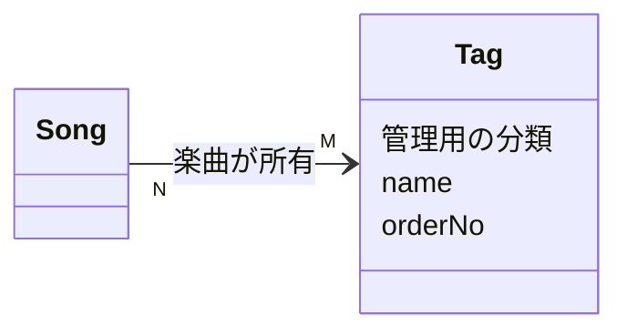

# Tag Spec

関連: ADR-0036

## 用語

- **Tag (タグ)**: 楽曲、イベント、リリースグループ、メディアを、コラボ、タイアップ先、シリーズなどの観点で横断的にまとめる管理用の分類
- Tag の永続フィールドは `tagId` / `name` (一意) / `orderNo` のみ
- タグ付けは付けられる側が持ち、対象ごとに別々に記録する。現在は楽曲だけに付けられる

## できること

- Admin: Tag の一覧・検索・取得・作成・更新・削除
- Admin: 名前の部分一致検索、名前または表示順のソート、ページング
- Admin: 一覧に、タグが付いている楽曲の件数を出す
- Admin: タグ詳細の楽曲タブに、非公開も含めてタグが付いた楽曲を出す。楽曲検索 API の `tag_id` で絞り込む
- 1 つの記録に同じタグを重ねて付けられない
- 記録に付いたタグは、タグの表示順で並べる
- どの記録にも付いていない Tag は削除できる
- 対象の記録を削除すると、その記録のタグ付けも消える
- `ReadTag` / `WriteTag` で操作を認可し、作成・更新・削除は Tag を対象に監査記録する

## できないこと

- Viewer に Tag を出さない
- 記録に付いている Tag は削除できない。先にすべての記録から外す
- 記録ごとのタグの並び順、タグの備考・色・階層は持たない
- 各対象の一覧画面に、タグで絞り込む検索条件は持たない
- 既存 General ユーザーに Tag 権限を自動付与しない

## 主な関係

