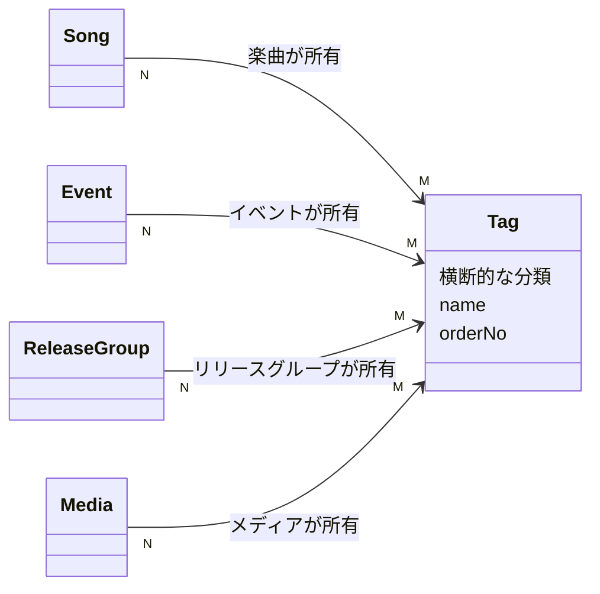

# Tag Spec

関連: ADR-0036、ADR-0037

## 用語

- **Tag (タグ)**: 楽曲、イベント、リリースグループ、メディアを、コラボ、タイアップ先、シリーズなどの観点で横断的にまとめる分類。すべての Tag を Viewer にも出し、Tag ごとの公開可否は持たない
- Tag の永続フィールドは `tagId` / `name` (一意) / `orderNo` のみ
- タグ付けは付けられる側が持ち、対象ごとに別々に記録する。楽曲、イベント、リリースグループ、メディアに付けられる

## できること

- Admin: Tag の一覧・検索・取得・作成・更新・削除
- Admin: 名前の部分一致検索、名前または表示順のソート、ページング
- Admin: 一覧に、タグが付いている楽曲、イベント、リリースグループ、メディアの件数を出す
- Admin: タグ詳細の対象ごとのタブに、非公開も含めてタグが付いた記録を出す。各対象の検索 API の `tag_id` で絞り込む
- Viewer: 公開中の楽曲・イベント・リリースグループの一覧 item に、付いた Tag (`tagId` / `name` / `orderNo`) を載せる
- Viewer: 楽曲・イベント・リリースの詳細に Tag を出す。Tag からは同じ種類の一覧へ `?tag=<tagId>` 付きで飛ぶ
- Viewer: 楽曲・イベント・リリースの一覧を、Tag のセレクトとテキスト検索で絞り込める
  セレクトの選択肢はその一覧の公開中の記録に付いた Tag だけで、Tag の表示順に並べる。1 つも無ければセレクトを出さない
  選んだ Tag は `?tag=` と同期し、存在しない `tagId` はすべての Tag として扱う
- 1 つの記録に同じタグを重ねて付けられない
- 記録に付いたタグは、タグの表示順で並べる
- どの記録にも付いていない Tag は削除できる
- 対象の記録を削除すると、その記録のタグ付けも消える
- `ReadTag` / `WriteTag` で操作を認可し、作成・更新・削除は Tag を対象に監査記録する

## できないこと

- Viewer にメディアの Tag を出さない
- Viewer に Tag 専用のエンドポイントや、Tag ごとの記録をまとめたページを持たない
- Viewer の一覧の行には Tag を出さない
- 記録に付いている Tag は削除できない。先にすべての記録から外す
- 記録ごとのタグの並び順、タグの備考・色・階層は持たない
- Admin の各対象の一覧画面に、タグで絞り込む検索条件は持たない
- 既存 General ユーザーに Tag 権限を自動付与しない

## 主な関係

